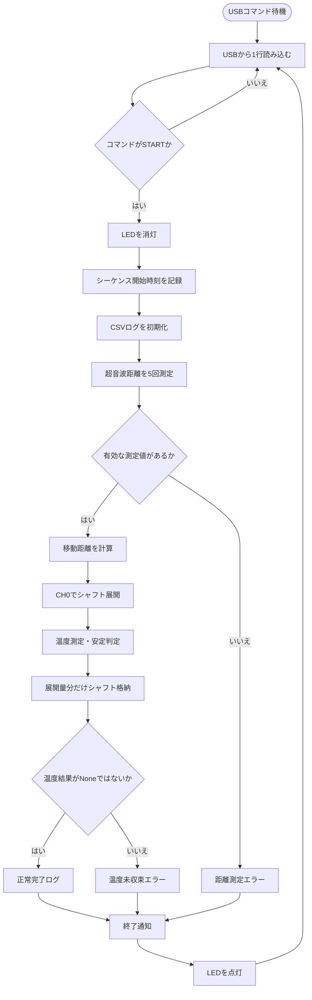
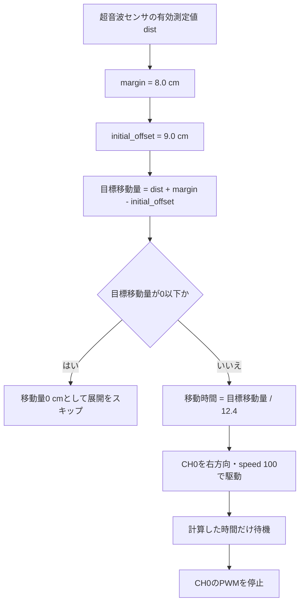
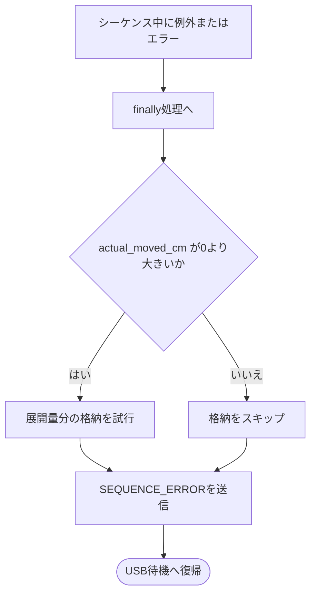

# 探査システム プログラム仕様書（ソースコード確認版）

- 作成日：2026-11-12
- 対象：Pico 2 W側の `main(1).py`、`motor(2).py`、`distance(1).py`、`temperature(1).py`
- 仕様の根拠：今回確認できた各ソースコード
- 注意：ソースに実装されている動作と、構成上の予定・未実装事項を分けて記載する。

---

## 1. システム概要

本システムは、Raspberry Pi Pico 2 Wを中心に、超音波センサで地面までの距離を測定し、その距離からシャフト（アーム）の展開量を計算する。展開後に土壌温度を測定し、測定終了後に展開した分だけシャフトを格納する。

Pico 2 WはUSBシリアルから `START` を受信すると一連の処理を開始する。処理状況はUSBシリアルへ出力され、測定・処理イベントはPico内のCSVファイルにも記録される。

### 1.1 プログラム構成

| ファイル | 役割 |
|---|---|
| `main(1).py` | 全体制御、USBシリアル入力、ログ記録、各処理の呼び出し |
| `distance(1).py` | 超音波センサによる距離測定、複数回測定値の中央値算出 |
| `motor(2).py` | PCA9685初期化、CH0連続回転サーボの展開・停止・格納 |
| `temperature(1).py` | DS18x20温度センサの読み取り、温度安定判定 |

## 2. ハードウェア・接続仕様

### 2.1 Pico 2 WとPCA9685

| 項目 | ソースコード上の設定 |
|---|---|
| I2Cバス | I2C(0) |
| SDA | GP0 |
| SCL | GP1 |
| I2Cクロック | 100,000 Hz（100 kHz） |
| PCA9685アドレス | `0x40` |
| PCA9685 PWM周波数 | 50 Hz |

### 2.2 PCA9685チャンネル割り当て

| チャンネル | 機器 | 用途 | 現在確認できたプログラムでの扱い |
|---|---|---|---|
| CH0 | GWS S35 STD | シャフト展開・格納（連続回転） | `motor(2).py` から制御 |
| CH4 | TowerPro MG996R | 砂機構 | メイン処理から呼び出されていない |
| CH8 | TowerPro SG90 | 開閉機構 | 確認した `main(1).py` と `motor(2).py` には制御処理がない |

**重要：** CH8のSG90は機器構成として指定されているが、今回確認できたメインプログラムには開く・閉じる処理が実装されていない。したがって、現時点のソースコードに基づく実際の処理フローには、SG90の開閉動作を含めない。CH8の開閉処理や「シャフト展開終了2秒前に閉じる」処理を実装する場合は、別途コード追加が必要である。

また、`moter4_180.py` は単体サーボ試験用コードであり、今回のメインシーケンスの仕様根拠には含めない。

## 3. 全体処理フロー

### 3.1 通常動作



### 3.2 シャフト移動量の計算フロー



### 3.3 エラー時の格納処理



## 4. 重要変数一覧（プログラマ向け）

### 4.1 `main(1).py`

| 変数・引数 | 現在値 | 意味・変更時の影響 |
|---|---:|---|
| `LOG_FILE` | `"log_result.csv"` | Pico内に保存するログファイル名 |
| `samples` | `5` | 距離測定の試行回数。`get_stable_distance(samples=5)` として指定 |
| `margin` | `8.0 cm` | 測定距離に加える余裕分 |
| `initial_offset` | `9.0 cm` | 計算した総距離から差し引く初期オフセット |
| `direction` | `"right"` | シャフト展開方向 |
| `speed` | `100` | 連続回転サーボへの速度指令値。PWM値の計算に使用 |
| `tolerance` | `0.01 ℃` | 温度安定判定の許容変動幅 |
| `stable_duration_sec` | `10.0 秒` | 温度変動幅を確認する時間窓 |
| `max_wait_sec` | `180 秒` | 温度測定の最大待機時間 |
| `ignore_sec` | `10.0 秒` | 温度測定開始後、安定判定から除外する時間 |

### 4.2 `motor(2).py`

| 変数・引数 | 現在値 | 意味・変更時の影響 |
|---|---:|---|
| `I2C_SDA` | `0` | I2C SDAのGPIO番号（GP0） |
| `I2C_SCL` | `1` | I2C SCLのGPIO番号（GP1） |
| `MOTOR_CHANNEL` | `0` | シャフト用サーボのPCA9685チャンネル |
| `SPEED_CM_PER_SEC` | `12.4` | 距離から駆動時間を計算するための速度換算値 |
| `address` | `0x40` | PCA9685のI2Cアドレス |
| `freq_hz` | `50` | PCA9685のPWM周波数 |
| `direction` | `"right"` / `"left"` | 展開・格納の回転方向 |
| `speed` | `100` | PWM指令値を決める速度パラメータ |
| `margin_cm` | `8.0` | 関数の既定余裕値。main側からも指定される |
| `initial_offset_cm` | `9.0` | 関数の既定オフセット。main側からも指定される |

### 4.3 `distance(1).py`

| 変数・引数 | 現在値 | 意味 |
|---|---:|---|
| `trig` | GP14 | 超音波センサのTrig端子 |
| `echo` | GP15 | 超音波センサのEcho端子 |
| Echo復帰待ち | 10,000 µs | 前回のEcho信号がHIGHのままの場合の待機上限 |
| Echo立ち上がり待ち | 30,000 µs | EchoがHIGHになるまでのタイムアウト |
| Echoパルス幅待ち | 45,000 µs | EchoがLOWに戻るまでのタイムアウト |
| 有効距離 | 2.0～400.0 cm | 範囲外の測定値を無効にする |
| `samples` | 関数既定値7、mainから5を指定 | 測定回数 |
| 測定間隔 | 0.06秒 | 各測定の間の待機時間 |

### 4.4 `temperature(1).py`

| 変数・引数 | 現在値 | 意味 |
|---|---:|---|
| `gp_pin` | GP16 | DS18x20のデータ接続GPIO |
| `tolerance` | 0.01 ℃ | 直近の温度変動幅の許容値 |
| `stable_duration_sec` | 10.0秒 | 直近データを確認する時間幅 |
| `max_wait_sec` | 180秒 | 測定ループの最大時間 |
| `ignore_sec` | 関数既定値1.0秒、mainから10.0秒を指定 | 最初の温度データを判定から除外する時間 |
| 温度変換待ち | 750 ms | `convert_temp()` 後の読み取り待機 |
| 追加待機 | 0.5秒 | 各測定処理の後の待機 |

## 5. シャフト移動量の計算仕様

### 5.1 計算式

`main(1).py` は距離測定後、次の値を設定して `move_arm_by_distance()` を呼び出す。

```python
margin = 8.0
initial_offset = 9.0

ret = move_arm_by_distance(
    distance_cm=dist,
    direction="right",
    speed=100,
    margin_cm=margin,
    initial_offset_cm=initial_offset,
)
```

`motor(2).py` 内では次の計算を行う。

```python
target_total_cm = distance_cm + margin_cm
actual_move_cm = target_total_cm - initial_offset_cm
```

したがって現在の設定では、

\[
\text{シャフト移動量} = \text{測定距離} + 8.0 - 9.0
\]

\[
\boxed{\text{シャフト移動量} = \text{測定距離} - 1.0\ \mathrm{cm}}
\]

測定距離そのままでも、測定距離に5cmを加えた値でもない。測定距離から1cm差し引いた値が、プログラム上の目標移動量となる。

### 5.2 計算例

| センサ測定距離 | 計算 | プログラム上の移動量 |
|---:|---|---:|
| 10 cm | 10 + 8 - 9 | 9 cm |
| 20 cm | 20 + 8 - 9 | 19 cm |
| 30 cm | 30 + 8 - 9 | 29 cm |
| 40 cm | 40 + 8 - 9 | 39 cm |

`actual_move_cm` が0以下の場合、モーター関数は `0.0` を返し、PCA9685を初期化せずに展開をスキップする。

### 5.3 距離から駆動時間への変換

`motor(2).py` では、次の式で駆動時間を計算する。

\[
\text{run\_time} = \frac{\text{actual\_move\_cm}}{12.4}
\]

`SPEED_CM_PER_SEC = 12.4` は、1秒あたり12.4cm進むという前提の換算値である。

例：移動量19cmの場合

\[
19 \div 12.4 \approx 1.53\ \mathrm{秒}
\]

つまりプログラムはCH0を約1.53秒間駆動する。

**注意：** 12.4cm/sはソースコードに設定された換算値であり、実際の移動距離をセンサでフィードバックしているわけではない。実際の移動量は、サーボ個体、電源、負荷、機構抵抗などによりずれる可能性がある。

## 6. モーター制御の詳細

### 6.1 CH0のPWM指令

`spin()` は `speed` から次の値を計算する。

```python
offset = int(150 * (speed / 100.0))

if direction == "left":
    pwm_val = 300 + offset
else:
    pwm_val = 300 - offset
```

現在の `speed=100` の場合：

- `offset = 150`
- 右方向：`pwm_val = 150`
- 左方向：`pwm_val = 450`

この値をPCA9685のCH0へ設定する。`force_stop()` はCH0のPWMを `4096` に設定する。

### 6.2 展開処理

1. I2C(0)をGP0/GP1、100kHzで初期化する。
2. I2Cデバイスをスキャンする。
3. デバイスが1つも検出されない場合は `False` を返す。
4. PCA9685（アドレス0x40）を初期化する。
5. PWM周波数を50Hzに設定する。
6. CH0を一度停止する。
7. 0.5秒待機する。
8. CH0を指定方向・速度で駆動する。
9. 計算した `run_time` 秒だけ待機する。
10. `finally` でCH0を停止する。
11. 実際に動かしたとみなす距離 `actual_move_cm` を返す。

### 6.3 格納処理

- 格納距離には、展開関数から返された `actual_moved_cm` を使用する。
- 現在のmain側指定は `direction="left"`、`speed=100`。
- 格納時間は展開と同じく `move_cm / 12.4` 秒。
- 格納処理の最後にCH0を停止する。

### 6.4 速度パラメータ変更時の注意

`speed` はPWM指令値を変えるが、駆動時間の計算式は `SPEED_CM_PER_SEC` 固定である。したがって `speed` を100以外に変更しても、速度換算値は自動補正されない。速度を変更する場合は、実機で速度を再測定し、`SPEED_CM_PER_SEC` も再校正する必要がある。

## 7. 距離測定の詳細

### 7.1 単発測定 `get_distance()`

1. EchoがHIGHのまま残っていないか確認し、最大10ms待つ。
2. TrigをLOWにして2µs待機する。
3. TrigをHIGHにして10µsのトリガーパルスを出す。
4. TrigをLOWに戻す。
5. Echoの立ち上がりを最大30ms待つ。
6. Echoの立ち下がりを最大45ms待つ。
7. EchoのHIGH時間から距離を計算する。

計算式：

\[
\text{distance} = \frac{\text{duration} \times 0.0343}{2}
\]

`duration` はµs単位であり、0.0343は音速をcm/ms相当に換算するためのコード上の係数である。算出値が2.0～400.0cmの範囲内であれば有効値として返し、それ以外は `None` を返す。

### 7.2 複数回測定 `get_stable_distance(samples=5)`

- mainから `samples=5` を指定しているため、最大5回測定する。
- 各測定後に0.06秒待つ。
- `None` ではない有効値だけをリストに格納する。
- 有効値が0件なら `None` を返す。
- 有効値を昇順にソートし、中央の値を返す。

**重要：** 5回すべて成功することを必須としていない。有効値が1件以上あれば、その有効値群の中央値を返す。

## 8. 温度測定の詳細

### 8.1 センサ初期化

- GP16にOneWireを設定する。
- DS18x20センサをスキャンする。
- 検出したROM一覧の先頭 `roms[0]` を測定対象にする。
- センサが見つからない場合はログにエラーを記録し、`None` を返す。

### 8.2 測定・安定判定

mainから渡す値：

```python
final_temp = measure_until_stable(
    tolerance=0.01,
    stable_duration_sec=10.0,
    max_wait_sec=180,
    ignore_sec=10.0,
    log_func=log_event,
)
```

処理の概要：

1. 測定開始時刻を記録する。
2. 温度変換を開始する。
3. 750ms待って温度を読み取る。
4. 測定開始から10秒未満のデータは安定判定に使わない。
5. 10秒経過後は、直近10秒間の温度データを抽出する。
6. その範囲の最大値と最小値の差を求める。
7. 直近データが10秒分蓄積され、かつ最大値－最小値が0.01℃以下なら収束と判定する。
8. 収束した時点の温度を返す。
9. 最大180秒に達した場合は、最後の測定温度を返す（履歴が空なら `None`）。

### 8.3 温度判定に関する注意

- `ignore_sec` の関数既定値は1.0秒だが、mainから10.0秒を渡しているため、通常のメイン処理では10秒が適用される。
- 温度変換の750ms待機と追加の0.5秒待機があるため、測定間隔は概ね1.25秒程度になる。
- 収束条件は「10秒間の温度の最大値と最小値の差が0.01℃以内」である。隣り合う測定値の差だけを比較しているわけではない。
- **現状コードでは、180秒のタイムアウト時にも最後の温度値を返す。** main側は戻り値が `None` でない場合に成功扱いするため、センサが検出されていてタイムアウトしたケースでも、最終判定が成功表示になる可能性がある。タイムアウトと収束成功を区別したい場合は、戻り値や判定フラグの設計変更が必要である。

## 9. USBシリアル通信・LED

### 9.1 起動時

- `main()` が実行される。
- Pico内蔵LEDを点灯する。
- `sys.stdin.readline()` でUSBシリアルから1行読み込む。
- 受信文字列の前後の空白・改行を `strip()` で取り除く。

### 9.2 コマンド

| コマンド | 現在のソースコードでの動作 |
|---|---|
| `START` | LED消灯後、`run_sequence()` を実行 |
| `STOP` | 専用処理なし。停止コマンドとして実装されていない |
| その他 | 何も実行せず、次の入力を待つ |

シーケンスが終了するとLEDを再点灯し、USBコマンド待機に戻る。

**重要：** 現在確認した `main(1).py` は `START` のみを処理する。`STOP` を実行中に受け付ける別スレッドや停止フラグはない。また `readline()` は1行入力を待つため、実行中に別のSTOPコマンドを監視する構造にもなっていない。

## 10. ログ仕様

### 10.1 保存先・形式

- ファイル名：`log_result.csv`
- 保存場所：Pico内ストレージ
- 文字コード：新規作成時にUTF-8 BOMを書き込む
- STARTごとに新規テスト開始の区切り行とヘッダを追記する（既存ファイルがある場合）。

### 10.2 CSV列

| 列名 | 内容 |
|---|---|
| 経過時間(秒) | シーケンス開始からの経過時間 |
| 時刻(時:分:秒) | PicoのRTCから取得した時刻 |
| フェーズ | 処理段階・イベント名 |
| 測定距離(cm) | 超音波センサの測定距離 |
| 移動量(cm) | シャフトの移動量 |
| 予備分(cm) | margin相当の記録欄 |
| 温度(℃) | 温度測定値 |
| 詳細 | 補足情報・エラー内容 |

ログはPico内CSVへ追記すると同時に、USBシリアルへ `[LOG]` を付けて出力する。書き込みに失敗した場合は `[Log Error]` をUSBシリアルへ出力する。

## 11. エラー・例外処理

| 発生箇所 | 現在の処理 |
|---|---|
| 距離測定で有効値なし | `超音波距離取得失敗` を記録し、シーケンスを終了 |
| PCA9685のI2Cスキャン結果が0件 | モーター関数が `False` を返す |
| モーター展開が `False` | `モーター展開失敗` を記録して終了 |
| 温度センサ未検出 | 温度関数が `None` を返す |
| 温度測定タイムアウト | 最後の温度値を返す（main側で成功扱いになる可能性あり） |
| その他の例外 | `except` で例外内容を記録 |
| 展開量が残った状態で終了 | `finally` で格納を試行 |

### 11.1 注意すべき実装上の挙動

1. `finally` は正常終了・エラー終了のどちらでも実行される。
2. `actual_moved_cm > 0` の場合、`finally` でシャフト格納を試行する。
3. そのため、温度測定中に例外が発生した場合も格納が試行される。
4. 距離測定エラーなど、展開前に終了した場合は `actual_moved_cm` が0のため格納しない。
5. 格納処理自体に失敗した場合、その例外は `finally` 内で握りつぶされる。
6. `main()` のコマンド待機ループには `STOP` 分岐がないため、実行中のソフトウェア停止機能はない。
7. PWM停止指令はモータ電源を物理的に遮断するものではない。

## 12. プログラマが変更・確認する主要パラメータ

| 変更したい内容 | 主に変更する場所 | 変更対象 |
|---|---|---|
| センサ測定距離に加える余裕を変更 | `main(1).py` | `margin = 8.0` |
| 初期オフセットを変更 | `main(1).py` | `initial_offset = 9.0` |
| シャフトの移動速度換算を変更 | `motor(2).py` | `SPEED_CM_PER_SEC = 12.4` |
| シャフトの回転指令を変更 | `main(1).py` と `motor(2).py` | `speed`、`direction`、`spin()` |
| PCA9685の接続先を変更 | `motor(2).py` | I2C番号、SDA、SCL、アドレス |
| 距離測定回数を変更 | `main(1).py` | `samples=5` |
| 距離センサの有効範囲を変更 | `distance(1).py` | `2.0 <= distance <= 400.0` |
| 温度安定の厳しさを変更 | `main(1).py` | `tolerance`、`stable_duration_sec` |
| 温度の初期除外時間を変更 | `main(1).py` | `ignore_sec` |
| 温度測定の最大時間を変更 | `main(1).py` | `max_wait_sec` |
| ログファイル名を変更 | `main(1).py` | `LOG_FILE` |

## 13. 現在のソースコードで未実装・未確認の事項

以下は機器構成やこれまでの要望として挙がっているが、今回確認したソースコード上では実装を確認できない事項である。

1. CH8のSG90を開く処理。
2. CH8のSG90を閉じる処理。
3. シャフト展開終了の2秒前にSG90を閉じるタイミング制御。
4. USBからの `STOP` コマンド受信と実行中シーケンスの中断。
5. STOP時にCH0・CH8を停止する処理。
6. STOP後に自動格納・自動開閉を行わない制御。
7. 距離測定中・温度測定中に停止要求を定期確認する仕組み。

したがって、これらを含むフロー図や仕様を「実装済み」として扱わないこと。機能追加後は、実際の更新コードを再確認して本書を改訂する。

## 14. 実機確認・校正項目

- `SPEED_CM_PER_SEC = 12.4` が現在の機構・負荷で妥当か、一定距離を複数回動かして実測する。
- `speed=100` 以外を使う場合は速度換算値も再校正する。
- 距離センサの設置角度・対象面・測定距離による誤差を確認する。
- 5回のうち一部だけ有効な場合でも中央値で処理が進むことを理解したうえで、必要なら有効サンプル数の最低条件を設ける。
- 温度センサが複数ある場合、現在は `roms[0]` のみを測定していることを確認する。
- 温度タイムアウト時に成功と誤認しないよう、収束成功とタイムアウトの戻り値を区別する。
- `finally` による自動格納が、実機の安全条件に合っているか確認する。
- STOP機能を追加する場合、USB入力の監視方式、各待機処理の中断方法、格納の扱いを設計・実機試験する。
- SG90をCH8に組み込む場合、開閉位置のPWMパルス幅と機構の可動範囲を無負荷から調整する。

---

## 15. 仕様の読み方

- **実装済み：** 今回確認したソースコードに記述がある動作。
- **未実装・未確認：** 機器構成や要望にはあるが、今回確認したソースコードからは実装を確認できない動作。
- **設定値：** ソースコードに書かれている現在値。実機での正確さや性能を保証する測定値とは限らない。
